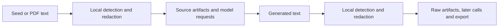

# PII protection

Configure one local PII policy for the run. Arka checks source record text before source artifacts or source decision requests. It checks generated text before raw-response artifacts and later model calls. Omit `pii` to keep existing behavior.



## Configure GLiNER2

Install the optional model runtime and provision the dedicated checkpoint before starting a run. This is an explicit download step. Arka does not fetch missing files during pipeline execution.

```sh
uv sync --extra pii
uv run --extra pii hf download fastino/gliner2-privacy-filter-PII-multi \
  config.json encoder_config/config.json model.safetensors \
  tokenizer.json tokenizer_config.json \
  --revision 1cb4166094dc58fa8d836429f060d6c95f62b495 \
  --local-dir ./models/gliner2-pii
```

Add a top-level section to the pipeline configuration. Paths are relative to the configuration directory, as with source files. Select only the categories the dataset needs to protect.

```yaml
pii:
  backend: gliner2
  model_path: ./models/gliner2-pii
  languages: [en, fr]
  entities: [person, email, phone_number, address, api_key]
  threshold: 0.5
  placeholder_template: "[{entity}]"
  # Optional. Without a ratio, Arka retains redacted samples.
  max_redacted_ratio: 0.15
  blocked_entities: [api_key]
```

The supported checkpoint is [fastino/gliner2-privacy-filter-PII-multi](https://huggingface.co/fastino/gliner2-privacy-filter-PII-multi). Its documented languages are `en`, `fr`, `es`, `de`, `it`, `pt` and `nl`. Language configuration declares required coverage. It does not identify each record's language or enable an arbitrary language.

Supported entity labels are:

```text
person full_name first_name middle_name last_name date_of_birth
email phone_number address street_address city state_or_region postal_code country
government_id national_id_number passport_number drivers_license_number
license_number tax_id tax_number
bank_account account_number routing_number iban payment_card card_number
card_expiry card_cvv username ip_address account_id sensitive_account_id
password secret api_key access_token recovery_code
sensitive_date document_date expiration_date transaction_date
```

Arka runs the model locally on CPU and serializes inference across pipeline threads. It uses overlapping long-document extraction and global character offsets. It checks returned offsets against the original text. Invalid spans or extraction errors stop the affected boundary. Startup checks require the five model files above and a loadable model. They do not certify the training provenance of a replacement checkpoint.

## Configure identifier patterns

The built-in regex backend needs no optional runtime. It supports `email`, `phone_number`, `payment_card`, `iban` and `ip_address`. It does not recognize names or postal addresses. Phone matching requires an explicit international prefix. Card candidates pass a Luhn check, IBAN candidates pass a mod-97 check, and IP addresses pass Python's address validation. These checks do not prove that an identifier is assigned or private.

```yaml
pii:
  backend: regex
  languages: [en]
  entities: [email, payment_card]
```

The regex patterns are independent of prose language. Their coverage is limited to the implemented formats. Unsupported entities fail configuration validation. GLiNER2 also rejects unsupported declared languages. Missing optional dependencies or model files fail before Arka reads source text. There is no fallback to another detector.

## Replacement and rejection

Arka replaces each connected group of overlapping spans once. The first span in start order determines the placeholder category, with the longest span first at a shared start. Category counts retain all unique detector spans. Placeholders have printable delimiters on both sides of `{entity}`. Arka does not redact the inside of an existing placeholder again.

The ratio is the union of original matched UTF-8 bytes divided by the original scanned text bytes. Overlaps count once. JSON keys, role labels and other non-text values do not enter the denominator. A sample is rejected only when its ratio is greater than `max_redacted_ratio`. A selected `blocked_entities` match rejects it regardless of the ratio. The example's 15% threshold is optional.

Each source record and generated candidate is a separate unit. Evol-Instruct checks its intermediate instruction separately before requesting a response. A rejected intermediate instruction prevents the response call. Auxiliary judge output is redacted before use; sample rejection thresholds apply to sources and generators.

For structured output, Arka scans decoded text values and retains the schema and usage information. Unparseable structured output is discarded with a payload-free marker. It cannot be retained as an unredacted debug fragment. When the client exposes the rejected response, Arka retains its token usage and reported cost. Transport or SDK failures that expose no response cannot provide that usage.

Generators explicitly request safe rejected outputs so they can save rejection summaries and available usage. Judge and scoring calls preserve `LLMClientError` codes with fixed, payload-free messages. Their existing record-drop or batch-skip handling still applies to provider and parse failures. Detector failures still stop processing.

## Artifacts and resume

- `pii_policy.json` records the effective policy fingerprint in the run directory. It includes the configured policy and hashes of local model files.
- `pii_report.json` records per-stage record checks, category counts and PII rejection reasons. Check counts can include repeated boundary checks of the same record.
- `pii_dropped.parquet` contains only protected copies of records rejected at a record boundary. Their stage events contain counts and reasons, not matched source text.
- Generator raw rows retain protected text, usage and rejection summaries where available. Normal generator statistics count rejected candidates.
- Taxonomy generation writes protected rejected records to `dropped.parquet`, including an explicit marker record for unparseable output. Its drop counts include both privacy and decision rejections.
- Redacted records get new payload hashes and IDs. Root records update their root ID. Generated records preserve their parent lineage. PDF page and character offsets continue to refer to the original extracted text.

Use a new run ID after changing the PII policy or local model files. Arka rejects reuse of an incompatible policy before reading stage artifacts or overwriting resolved configuration. Existing runs without a PII policy cannot be resumed with protection enabled. This does not clean old unprotected artifacts.

Each stage attempt starts fresh `pii_report.json` and `pii_dropped.parquet` files. Multiple protection boundaries within that attempt share the totals. Retrying a failed stage replaces its previous attempt's totals. Resuming a completed stage skips execution and preserves its artifacts.

With PII protection enabled, Arka disables the native client's SQLite response cache because it stores provider output before redaction. Protected generator rows and completed-stage artifacts still support resume. An interrupted judge or Evol-Instruct stage can repeat calls that would otherwise use the native response cache.

## Scope and limits

The protected record fields are document chunk text and conversation instruction, response, system, reasoning and text turn content. Conversation role labels remain unchanged. Non-text turn content fails the record boundary. Input JSONL and CSV ingestion retains its existing field selection.

Original seed files, PDFs, user configuration, filenames, document identifiers and arbitrary record metadata are outside this text policy. Use appropriate storage controls for those inputs. A detector can miss PII or over-redact useful text. The checkpoint's reported languages and categories do not establish recall on a particular dataset. Public and private names are not distinguished by this policy.

The [October 2026 research notes](tasks/pii-redaction/02-research-detector-options.md) explain why this PR uses the dedicated PII checkpoint. Fixture checks prove integration for known test values. They do not measure production recall, precision or dataset utility.

## Verify locally

```sh
just check
uv build
uv run python scripts/verify_pii_cli.py --output /tmp/arka-pii-regex-proof
uv run --extra pii python scripts/verify_pii_cli.py \
  --output /tmp/arka-pii-gliner-proof --model-path ./models/gliner2-pii
```

Use a fresh output directory. The helper uses a loopback provider, inspects requests and persisted artifacts, and checks resume without additional calls. The model cases use offline Hugging Face loading. Model provisioning must happen first.
