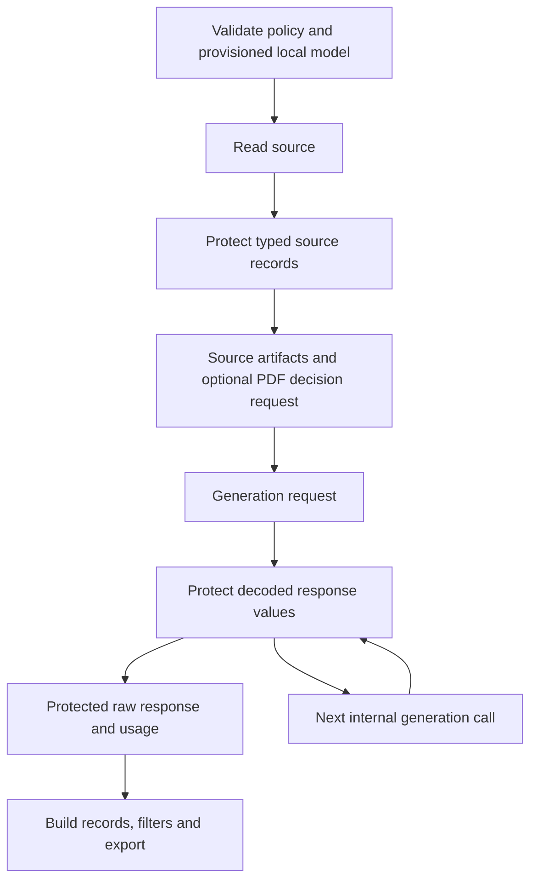

# Technical design for PII redaction

Address [issue #166](https://github.com/jayshah5696/arka/issues/166) in a separate managed worktree. The base is the latest fetched main revision above. PR #217 is not part of this branch.

## Agreed scope

The user selected local protection of source record text before persistence or model use, and generated text before persistence or later model calls. Users define supported languages and entity categories in configuration. The user then authorized using GLiNER after checking research available in October 2026, and requested implementation before opening the PR.

## Data flow



A downstream filter cannot protect source artifacts or generator raw files written before that filter. The policy therefore lives at the source and client boundaries. The runner also checks typed stage output before it writes the stage artifact.

## Selected model

The optional `pii` extra pins `gliner2[local]==2.1.0`. The recommended checkpoint is `fastino/gliner2-privacy-filter-PII-multi`, revision `1cb4166094dc58fa8d836429f060d6c95f62b495`. It has a documented 42-label schema and seven-language scope. GLiNER2.5 is newer general extraction work; this implementation uses the dedicated PII checkpoint rather than inferring PII quality from that version number.

The built-in regex backend remains available for its narrow identifier formats. Backend selection is explicit. There is no fallback from a missing or failed GLiNER model to regex. See the [research notes](02-research-detector-options.md) for current evidence and limits.

## Ownership

```text
src/arka/privacy/
├── config.py        # supported coverage and policy validation
├── policy.py        # spans, overlap union, byte ratio and replacement
├── runtime.py       # local GLiNER model loading and long-text inference
├── models.py        # typed summaries and record-boundary reports
├── records.py       # typed payload protection, identity and safe drops
└── boundaries.py    # outbound LLM text and returned output protection
```

StageContext exposes short protection methods. The runner creates one policy before source reads and shares it with each stage. GLiNER inference uses a lock because stages share the model across threads. Sources protect records before internal checks. Generators consume protected outputs before internal calls, raw writes and downstream decisions. Injected clients use the same guard.

The guard keeps protocol roles and schema keys intact. It scans decoded JSON string values, preserves parsed model types and usage, and suppresses payload-bearing exceptions. When the provider returns malformed structured text, the safe marker and rejection summary replace the fragment. A structured-response error carries the response internally so the guard can retain its usage without formatting raw text.

Safe rejected outputs are an explicit generator mode. Judge and scoring calls retain the `LLMClientError` contract and error codes with fixed messages. Their existing drop and batch-skip handlers remain effective. Switching modes reuses the underlying client without mutating another stage's wrapper.

GLiNER2 logs extraction exception messages upstream. The adapter replaces that logger's diagnostic and traceback with a fixed message. Detector failures still stop the boundary.

## Policy

The top-level `pii` section is optional. Omission preserves existing behavior and configuration hashes. When present, backend, languages and entities are required. Configuration rejects unsupported declared GLiNER languages and entities before running.

Replacement uses a category placeholder with printable delimiters. Connected overlapping detections are replaced once. Their union determines the original matched UTF-8 byte count. A blocked-category match rejects the unit. Otherwise, an optional matched-byte ratio rejects only values above the configured threshold. Omitting it retains redacted units. No universal 15% default is imposed.

Source records and generated candidates are separate units. Evol-Instruct checks the intermediate instruction before requesting the response. Rejections retain available usage and protected diagnostics. Auxiliary judge output is redacted; source and generator paths apply sample rejection thresholds.

Text fields cover document chunks and conversation instruction, response, system, reasoning and textual turn content. Protocol role labels are not scanned as prose. Non-text turn content fails explicitly. Seed ingestion keeps its existing field selection. Original input files, user configuration, filenames, document identifiers and arbitrary metadata are outside this text policy.

## Identity, artifacts and resume

Redaction updates the payload hash and record ID. Root records update their root ID. Generated records retain their parent lineage. Original PDF page and character coordinates remain unchanged.

The run stores a fingerprint of the policy and local model files before processing sources. A changed policy or checkpoint requires a new run ID. Existing runs without a PII policy cannot enable it through resume. Incompatible runs are rejected before reading their stage artifacts or overwriting resolved configuration.

Record-boundary reports contain counts and reasons. Rejected records are stored only after protection. Generator raw rows contain protected text and available usage. The runner includes source PII rejections in stage totals. These reports do not contain matched source strings.

The runner clears only `pii_report.json` and `pii_dropped.parquet` before each executed stage attempt. Boundaries within an attempt share totals; failed attempts do not accumulate across retries. Completed-stage resume preserves its files. Taxonomy generation stores protected privacy rejections and decision rejections together through `StageArtifacts`; malformed candidates use a payload-free audit marker. Its persisted drop rows match its drop count.

## Verification

Tests were written to fail before each logic change. They cover Unicode byte ratios, overlap union, repeated offsets, decoded JSON, malformed output, invalid coverage, missing models, detector failures, logging, source and generated boundaries, intermediate instructions, drops, retained usage and resume compatibility.

The CLI helper `scripts/verify_pii_cli.py` drives the installed CLI and SDK through a loopback provider. It checks outgoing requests, JSON artifacts, Parquet, logs and SQLite state. It includes real offline GLiNER inference and a long input with repeated names and emails. Fixture verification is separate from detection-quality evaluation.

The final [verification record](03-verification.md) contains commands, results and limits. The [user guide](../../pii.md) explains provisioning and configuration. The PR description uses show-me with a compact boundary diagram and an observed before-and-after fixture.
