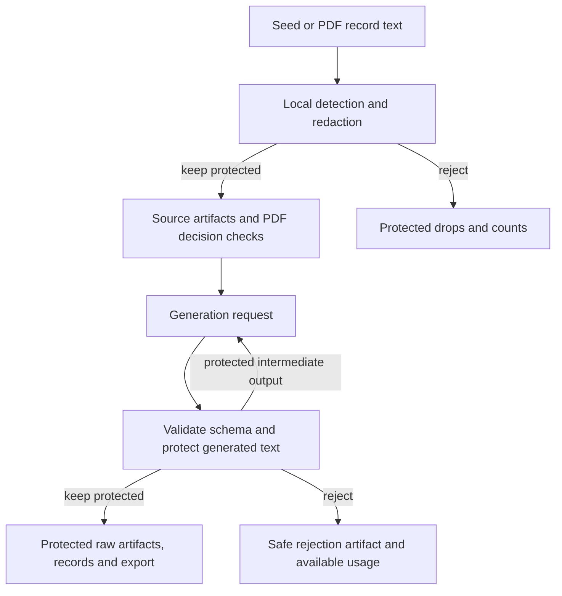

## Why

Arka saved source records and raw generated responses before downstream filters. This PR applies one local PII policy before those writes and before later model calls.

Closes #166.

## Where protection happens



The intermediate-output loop covers Evol-Instruct's instruction before its response call. Prompt, transform and taxonomy generation use the same client guard. Missing local model files, unsupported coverage and detector failures stop processing explicitly.

## Observed result

The real local GLiNER fixture produced this change:

```diff
- Contact John Smith at generated@example.com. He lives at 123 Main Street, London.
+ Contact [person] at [email]. He lives at [address].
```

[Checked export](https://github.com/jayshah5696/arka/blob/c-b/pii-redaction/docs/tasks/pii-redaction/evidence/gliner-dataset.jsonl).

## Configuration and decisions

Users select a backend, supported languages and entity labels through the optional top-level `pii` section. The selected backends are built-in identifier regex and optional local GLiNER2-PII through `gliner2[local]==2.1.0`. Provision the model before running. There is no detector fallback or implicit model download during a run.

```text
check each source record or generated candidate
  validate the generated schema, when applicable
  detect spans in the original text values
  merge overlaps and calculate original matched UTF-8 bytes
  replace matches with category placeholders
  if a blocked category matched, reject
  if the optional matched-byte ratio is exceeded, reject
  otherwise, retain the protected text
```

The ratio has no default. The guide's 15% value is an example. Rejections retain available provider usage. Malformed structured responses become a safe marker, including responses with sensitive unexpected field names.

Redaction updates payload hashes and record IDs while retaining parent lineage and original PDF coordinates. Policy and local-model fingerprints prevent incompatible resume. Omit `pii` to retain existing behavior.

## Code ownership

```text
src/arka/privacy/
├── config.py       # validate supported coverage and policy settings
├── runtime.py      # load the local GLiNER model and scan overlapping windows
├── policy.py       # merge spans, redact and decide rejection
├── boundaries.py   # protect requests and returned model output
├── records.py      # protect typed records, update identity and save drops
└── models.py       # typed summaries and reports
```

Source stages apply the policy before their internal checks. StageContext wraps production and injected LLM clients. The runner creates the shared policy, checks resume identity and protects stage output before persistence.

## Review fixes

Three reproduced findings from the review of `c2b12fa` are fixed:

| Finding | Change | Regression coverage |
| --- | --- | --- |
| Judge and scoring failures crashed protected runs | Preserve payload-free `LLMClientError` codes. Generators explicitly retain safe rejected output and available usage. | Provider and parse failures across labeling, double critic and Elo; safe errors across all client methods; generator wrapper isolation. |
| Failed stage retries duplicated PII counts and rows | Reset the two PII aggregation files before each executed attempt. Completed-stage resume preserves them. | Retry with and without resume, then completed resume with byte-identical artifacts. |
| Taxonomy drop counts omitted persisted rows | Write protected privacy drops and decision drops through `StageArtifacts`. Malformed responses get an audit marker. | Blocked entities, ratio rejection and malformed output, each with decisions enabled and disabled. |

The 18 added cases were written before the fixes. Sixteen exposed failing behavior or the missing generator-mode API; two were passing control cases. The focused boundary, recovery and taxonomy set passes all 39 cases.

## Research and limits

The October 17, 2026 [research refresh](https://github.com/jayshah5696/arka/blob/c-b/pii-redaction/docs/tasks/pii-redaction/02-research-detector-options.md) covers GLiNER2.5 and newer privacy studies. This PR uses the dedicated [GLiNER2-PII checkpoint](https://huggingface.co/fastino/gliner2-privacy-filter-PII-multi) for its documented configurable PII schema. Its documented coverage is 42 labels and seven languages. Different papers' benchmark scores do not establish a universal ranking.

Production recall, precision, throughput and dataset utility remain unmeasured. Public and private names are not distinguished. Original input files, user configuration, filenames and arbitrary metadata are outside this text policy. Changing the policy or model requires a new run ID and does not sanitize old artifacts.

The model runtime adds optional PyTorch and Transformers dependencies. This branch is based on main at `7790402` and is separate from PR #217.

[Configuration guide](https://github.com/jayshah5696/arka/blob/c-b/pii-redaction/docs/pii.md) · [Design](https://github.com/jayshah5696/arka/blob/c-b/pii-redaction/docs/tasks/pii-redaction/01-tech-design.md)

## Verification

Verification was rerun after the three review fixes. The published PR description pins the checked commit.

| Check | Observed result |
| --- | --- |
| `just check` | Lint and formatting passed. **614 passed, 1 skipped**. |
| `uv build` | Source package and wheel built. |
| Schema and existing examples | Schema regenerated. All nine examples validated and dry-ran. |
| Existing cleanup CLI fixture | PDF, taxonomy, cleanup and resume passed. Zero extra resume calls. |
| PII CLI fixture | **Eight cases passed**, including real offline GLiNER inference, four generation strategies across the fixture set, PDF decision requests, malformed output and persisted-artifact inspection. |
| Long-input fixture | Repeated names and emails redacted at both ends of a 4,500-character input. |
| PII fixture requests | 11 loopback provider calls. **Zero additional calls on resume**. |
| `git diff --check` | Passed. |

Feature tests and review regression tests were written before their corresponding logic changes. No paid API calls were made. The skipped test requires optional native-language prerequisites. Full reasoning and Hugging Face export checks were not repeated. Upstream model-type and TorchScript warnings did not prevent native inference.

[Verification record](https://github.com/jayshah5696/arka/blob/c-b/pii-redaction/docs/tasks/pii-redaction/03-verification.md) · [CLI results](https://github.com/jayshah5696/arka/blob/c-b/pii-redaction/docs/tasks/pii-redaction/evidence/cli-result.json)
