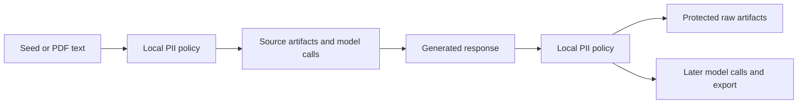

## Why

Arka wrote source records and raw generated responses before downstream filters. Issue #166 needs local PII protection at those earlier boundaries, including internal generation calls.

Closes #166.

## Changes



- Add an optional run-level `pii` policy with user-selected supported languages, entity labels, category placeholders and rejection rules. Existing configurations omit it and keep current behavior.
- Add optional local GLiNER2-PII through `gliner2[local]==2.1.0`. Require a provisioned local checkpoint before source reads. Use overlapping long-document inference and verified character offsets. Retain the narrow built-in identifier regex option.
- Protect source records before persistence and PDF decision requests. Protect prompt, transform, taxonomy and Evol-Instruct outputs before persistence or later model use. Preserve protocol roles and structured schemas.
- Reject malformed structured output before retaining raw JSON, including sensitive unexpected field names. Keep available response usage. Detector errors and upstream extraction diagnostics contain no source text.
- Add union-based UTF-8 byte ratios, blocked-category rejection, protected drop artifacts, category summaries, updated payload identity and policy/model fingerprints for resume.
- Add setup documentation, current research notes, regenerated schema and a CLI verification helper.

Actual real-model fixture:

```diff
- Contact John Smith at generated@example.com. He lives at 123 Main Street, London.
+ Contact [person] at [email]. He lives at [address].
```

## Research and reviewer notes

Research was refreshed through October 17, 2026. GLiNER2.5 is newer general extraction work. This PR selects the dedicated [GLiNER2-PII checkpoint](https://huggingface.co/fastino/gliner2-privacy-filter-PII-multi) for its documented configurable PII schema. The [research notes](https://github.com/jayshah5696/arka/blob/c-b/pii-redaction/docs/tasks/pii-redaction/02-research-detector-options.md) include newer privacy work and benchmark caveats. This is not a claim that GLiNER is universally best.

The checkpoint documents 42 labels and seven languages. Runtime checks do not establish its accuracy on a user's dataset. Precision, recall and production throughput remain unmeasured here. Original inputs, user configuration, filenames and arbitrary metadata are outside the text policy. Public and private names are not distinguished. The 15% ratio is an optional example, not a default.

The optional model adds PyTorch and Transformers. Core installs do not require them. Model provisioning is explicit and outside pipeline execution. A changed policy or model requires a new run ID; this does not clean old unprotected artifacts.

This branch starts from main at `7790402` and is separate from PR #217. See the [user guide](https://github.com/jayshah5696/arka/blob/c-b/pii-redaction/docs/pii.md) and [design](https://github.com/jayshah5696/arka/blob/c-b/pii-redaction/docs/tasks/pii-redaction/01-tech-design.md).

## Verification

- `just check`: lint and formatting passed, **596 passed, 1 skipped**. The skip is the existing optional native-language integration test.
- `uv build`: source package and wheel built.
- `just schema`, `just validate-examples`, `just dry-run-examples`: passed; all nine existing examples dry-ran.
- `scripts/verify_cleanup_cli.py`: existing PDF, taxonomy, cleanup and resume passed, with zero extra provider calls on resume.
- `scripts/verify_pii_cli.py --model-path /tmp/arka-gliner2-pii-model`: **eight cases passed**. Includes real offline GLiNER inference, all four generation strategies, PDF decision requests, malformed output, persisted-artifact inspection and repeated spans in a 4,500-character input. 11 loopback provider calls, zero extra resume calls.
- `git diff --check`: passed.

Tests were written to fail before each logic change. No paid API calls were made. Upstream model-type and TorchScript deprecation warnings did not prevent native inference. Full reasoning and Hugging Face export checks were not repeated.

Evidence: [verification record](https://github.com/jayshah5696/arka/blob/c-b/pii-redaction/docs/tasks/pii-redaction/03-verification.md), [CLI result](https://github.com/jayshah5696/arka/blob/c-b/pii-redaction/docs/tasks/pii-redaction/evidence/cli-result.json), [real redacted export](https://github.com/jayshah5696/arka/blob/c-b/pii-redaction/docs/tasks/pii-redaction/evidence/gliner-dataset.jsonl).
