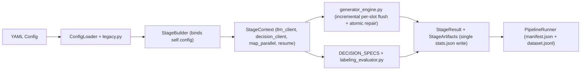

## Why

Arka's pipeline stages accumulated bypasses around configuration lookup, client construction, parallel execution, and artifact writing as Simula and decision-model stages were added. Stages scanned `ctx.config.pipeline` by class type, instantiated `LLMClient` or `ThreadPoolExecutor` directly, branched through central `if kind == ...` switchboards in `decision_stages.py`, and wrote or re-read `stats.json` multiple times per stage.

This PR deepens seven module seams so stage execution, configuration binding, generator slot checkpointing, labeling evaluation, and decision dispatch each flow through a single owner, backed by structural invariant tests and `AGENTS.md` rules.

## Changes

### 1. Module layout (`show-me` file tree)

```diff
 src/arka/
 ├── config/
+│   ├── legacy.py               # quarantines 4-section YAML translation and LegacyConfigNamespace
 │   └── models.py               # canonical pipeline stage and runtime configuration models
 ├── llm/
 │   ├── client.py               # adds content-addressed SQLite call cache with occurrence-indexed slot keys
 │   └── factory.py              # wires cache_db_path and read_cache through StageContext.llm_client()
 ├── pipeline/
 │   ├── decision_stages.py      # replaces if/elif chains with DecisionStageSpec registry
+│   ├── generator_engine.py     # streaming per-slot JSONL checkpointing, atomic truncated-tail recovery, post-checks
+│   ├── labeling_evaluator.py   # shared rubric scoring and optional threshold filtering
 │   ├── models.py               # adds StageResult dataclass and StageContext.map_parallel()
 │   ├── registry.py             # declarative StageSpec registry (including labeling_score)
 │   ├── runner.py               # passes resume flag to StageContext and consumes StageResult in memory
 │   ├── scoring_stages.py       # resolves LabelingScoreConfig on LabelingScoreStage while retaining bound config
 │   └── stage_builder.py        # binds self.config on every constructed Stage instance
 └── records/
     └── models.py               # adds Record.with_annotation() and single-event with_escalation()
```

### 2. Runtime control flow (`show-me` call tree diff)

```diff
 PipelineRunner.run(config, stages, run_id, resume)
   StageBuilder(config, project_root).build()
+    get_stage_spec(stage_cfg.type).get_stage_class()
+    stage.from_config(stage_cfg) -> binds stage.config = stage_cfg
   for stage in stages:
+    ctx = StageContext(..., checkpoint_manager=checkpoint_manager, resume=resume)
     stage.run(records, ctx)
-      self.get_stage_config(ctx, Cls) -> scans ctx.config.pipeline by isinstance
-      LLMClient(config=...) / ThreadPoolExecutor(...)
-      (ctx.work_dir / "stats.json").write_text(...)
-      re-reads stats.json to patch decision_usage
+      uses bound self.config (including repeated LabelingScoreConfig stages)
+      ctx.llm_client(override=...) -> writes SQLite llm_cache with occurrence-indexed slot keys, reads on resume=True
+      ctx.decision_client(override=...)
+      ctx.map_parallel(items, fn)
+        PromptBasedGeneratorStage._generate -> execute_generator_slots() (persists each slot as it completes without full-file rewrite)
+        LabelingQualityFilterStage / LabelingScoreStage -> evaluate_labeling()
+        run_decision_stage() -> DECISION_SPECS[kind]
+      StageArtifacts(ctx).write(report=StageReport(...)) -> single atomic write
+    returns StageResult / list[Record]
```

### 3. Behavior diagram (`show-me` Mermaid flow + fixture proof)



Actual fixture output from `uv run python scripts/verify_decisions_cli.py` and `uv run python scripts/verify_cleanup_cli.py --output /tmp/arka-pr217-verify-recheck`:

```json
{
  "cleanup_cli_proof": {
    "status": "passed",
    "provider_calls": 14,
    "pdf_export_count": 2,
    "taxonomy_export_count": 2,
    "resume_provider_calls": 0,
    "pdf_page_provenance": "pages 1 through 3 across blank page 2"
  },
  "decisions_cli_manifest_usage": {
    "requests": 9,
    "input_tokens": 90,
    "cache_hits": 18,
    "by_stage": {
      "01b_seed_gate": {"requests": 3, "cache_hits": 0},
      "02p_decision_panel": {"requests": 6, "cache_hits": 0},
      "03_label_quality": {"requests": 0, "cache_hits": 6},
      "02s_complexity_elo": {"requests": 0, "cache_hits": 3},
      "02r_reward_score": {"requests": 0, "cache_hits": 3},
      "03_double_critic": {"requests": 0, "cache_hits": 6}
    }
  }
}
```

### 4. Summary of the 7 deepened seams and review fixes

1. **Pure `StageResult` execution seam (`src/arka/pipeline/models.py`, `src/arka/pipeline/runner.py`)**: Added frozen `StageResult` with sequence compatibility and `partition_conversations()`. `PipelineRunner` consumes `StageResult` in memory and eliminates double `stats.json` write-then-read-then-rewrite cycles across generator, filter, taxonomy, and Elo stages.
2. **Composable decision and labeling evaluators (`src/arka/pipeline/decision_stages.py`, `src/arka/pipeline/labeling_evaluator.py`, `src/arka/pipeline/scoring_stages.py`)**: Replaced central `if kind == ...` chains in `decision_questions()` and `judge_answers()` with `DecisionStageSpec` registrations, moved `run_fasttext_language` to `cheap_filters.py`, and unified `LabelingQualityFilterStage` and `LabelingScoreStage` around `evaluate_labeling(drop_below_threshold=...)`. `LabelingScoreStage` resolves `LabelingScoreConfig` directly and retains its bound configuration across repeated `labeling_score` stages.
3. **Shared generator slot engine (`src/arka/pipeline/generator_engine.py`)**: Extracted parallel slot execution (`execute_generator_slots`), `raw_responses.jsonl` item checkpointing, `StageLLMOverride` resolution (`resolve_generator_llm_client`), and post-generation `fidelity_check` and `best_of_n` hooks (`apply_post_generation_decisions`). Completed slots flush to `raw_responses.jsonl` and update the SQLite checkpoint as each slot finishes without rewriting or truncating the file afterward. `load_raw_responses` sorts rows in memory, preserves valid rows before an incomplete final line using an atomic temporary-file replacement (`_atomic_write_jsonl`), and raises `ValueError` on corruption elsewhere instead of deleting the checkpoint file.
4. **Content-addressed SQLite LLM call cache and `ctx.map_parallel` (`src/arka/pipeline/checkpoint.py`, `src/arka/llm/client.py`, `src/arka/pipeline/models.py`, `src/arka/pipeline/runner.py`)**: `PipelineRunner` passes `resume=resume` to `StageContext`. `StageContext.llm_client()` attaches `cache_db_path` whenever `checkpoint_manager` is present so initial runs populate `llm_cache` while keeping `read_cache=False`, and resumed runs enable `read_cache=True`. `LLMClient` assigns occurrence-indexed cache keys within a client instance so repeated calls with the same prompt (such as multi-branch `EvolInstructRoundStage` generations with the same operator) store and recover independent samples on resume.
5. **Quarantined legacy config translation and bound stage config (`src/arka/config/legacy.py`, `src/arka/pipeline/stage_builder.py`)**: Moved 4-section config migration and `LegacyConfigNamespace` into `src/arka/config/legacy.py` and bound `stage.config` during `StageBuilder.build()` so multiple stages of the same class in one pipeline never collide.
6. **Declarative `StageSpec` registry (`src/arka/pipeline/registry.py`)**: Registered all 22 pipeline stage types (including `labeling_score` -> `LabelingScoreStage`) with declarative capability checks (`requires_decisions`, `requires_sequence_scoring`, `requires_embeddings`).
7. **Typed `Record` annotations and single-event escalations (`src/arka/records/models.py`)**: Added `Record.with_annotation()`, `RecordScores.get_annotation()`, and `Record.with_escalation()` while keeping `scores.quality_per_dim` synchronized for backward compatibility.

### 5. Permanent guardrails (`AGENTS.md` and `tests/unit/test_architecture_invariants.py`)

- Updated `AGENTS.md` (20 lines total, under the 50-line cap) with six `## Architecture Seams` rules.
- Added `tests/unit/test_architecture_invariants.py` to fail CI automatically if any `PipelineStageConfig` lacks a `StageSpec`, if any `backend="decision"` stage lacks a `DecisionStageSpec`, or if any stage module directly writes `"stats.json"` or instantiates `ThreadPoolExecutor`.

## Reviewer notes

The comparison base is `main` (`7790402`). All existing stage `run(records, ctx)` return shapes and `stats.json` field names remain backward-compatible. Internal Pydantic validation no longer emits `DeprecationWarning` noise during normal runs, while explicit calls to `migrate_old_config` preserve the warning for migration workflows.

## Verification

Checked on branch `t3/pipeline-architecture-review`:

- `just check` (`uv run ruff check .`, `uv run ruff format --check .`, `uv run pytest`): passed (`566 passed, 1 skipped` in 8.93s, `90%` total coverage, `98%` coverage on `generator_engine.py`, including 6 regression tests covering mid-batch slot persistence, truncated checkpoint recovery and corruption reporting, atomic checkpoint repair without post-batch truncation, runner LLM cache write/resume-read wiring, distinct branch sample recovery for `EvolInstructRoundStage` on resume, and repeated `labeling_score` rubrics).
- `uv build`: built `dist/arka-0.1.0.tar.gz` and `dist/arka-0.1.0-py3-none-any.whl`.
- `just validate-examples` and `just dry-run-examples`: all 9 example pipelines validated and dry-ran cleanly.
- `uv run python scripts/verify_cleanup_cli.py --output /tmp/arka-pr217-verify-recheck`: passed end-to-end PDF and taxonomy CLI generation, filtering, lineage, and resume (`14` loopback provider calls on initial run, `0` provider calls on `--resume`, `2` PDF records and `2` taxonomy records exported).
- `uv run python scripts/verify_decisions_cli.py`: passed end-to-end CLI decision transport, panel batching (`3` seed gate requests + `6` panel/inverse-critic requests, `18` downstream cache hits across labeling, complexity Elo, reward model, and double critic), and `--resume` with zero additional HTTP calls.
